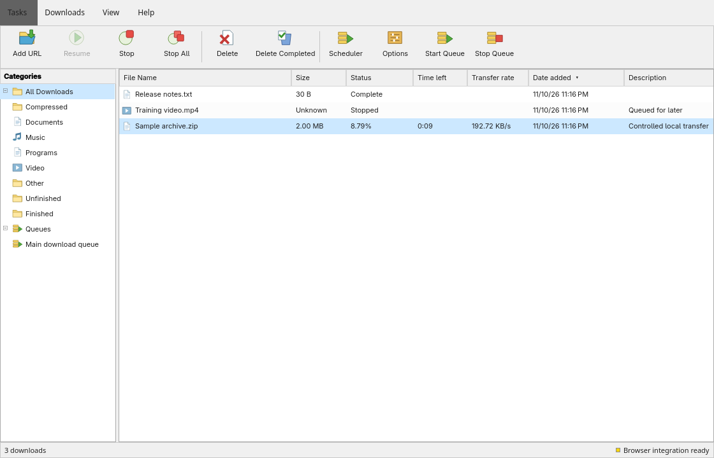

# IDM Native

A native Omarchy download manager with IDM's familiar menus, toolbar, category tree, download table and transfer dialogs. Browser capture, HLS/DASH media, queues, scheduling, proxies, authentication, website mirroring and completion actions are implemented independently in C++/Qt and free local tools.

The repository keeps the requested `idm-rust` name. [PR #1](https://github.com/earlyhours/idm-rust/pull/1) contains the working implementation on `research/idm-64318-analysis`; the default `master` branch remains the starter until the PR is merged.

The [70-feature ledger](docs/features.json) maps each requested capability to code, behavior tests and evidence. [The independent audit](docs/final-feature-audit.md) explains the coverage and limits. A pass means the documented behavior was tested, not every possible site or feature combination.

## Build, run and install

```sh
bin/build
build/idm-native open
bin/install
```

`bin/install` creates an Arch package and requests sudo to install the binary, launcher entry, browser extension resources and icon. The launcher name is **IDM Native**. Uninstall with `sudo pacman -R idm-native`.

Runtime tools are free: Qt 6, Python, yt-dlp, FFmpeg, curl, ClamAV, libnotify, libcanberra and NetworkManager. No paid analysis engine or service is required. ClamAV needs signature definitions before scanning; initialize or update them with `sudo freshclam`. The development machine's official definitions were updated and tested.

The implementation uses Qt/C++ conventions for Omarchy. The [investigation](docs/reverse-engineering/README.md) records evidence from the supplied IDM installer, including recovered request/response and browser-helper routines. The original Windows native source was not recovered or recompiled.

## Desktop workflow

**Add URL** opens the address and optional authentication dialog, followed by file information. Choose **Start Download** or **Download Later**. Double-click a row for file details, progress, speed, estimated time and connection/segment status. Toolbar, context menu and keyboard actions control the same persistent queue.

**Options** configures destination, connections, simultaneous jobs, retry policy, speed limits and schedules, HTTP/SOCKS proxies, clipboard monitoring, file-type filtering, site-specific headers/authentication, antivirus, notifications, sound and completion actions. Custom headers accept a JSON object of string values. Managed and hop-by-hop headers are filtered; invalid controls and oversized values are rejected.

**Scheduler** manages named queues and start/stop/repeat times. Jobs have priorities; queues have concurrency limits. Import/export supports a private JSON list or plain URL lines. **Website Grabber** performs a bounded, same-origin static crawl, rewrites links for offline use, and supports conditional periodic synchronization.

Schedules execute while the app is running. Closing it pauses transfers and saves state. Shutdown and network disconnect are opt-in, have a cancelable countdown, and are blocked if scanning fails or other work begins.

English and Danish are included, with locale and RTL fallback. The default interface follows classic IDM's light layout; dark mode is optional. Omarchy accent and language changes update live.

| Shortcut | Action |
| --- | --- |
| Ctrl+N | Add a URL |
| Space | Pause or resume the selected download |
| Delete | Confirm removing an unfinished queue entry |
| ? | Show shortcuts |
| Ctrl+Q | Save and quit |

## Browser and media capture

```sh
idm-native browser-install
```

The command registers the user-scoped native messaging host and prints the unpacked Chromium extension directory. Open `chrome://extensions`, enable developer mode, and load that directory. This is the normal one-time browser enablement step. The in-app browser integration panel provides the same installation action.

The extension adds context-menu capture, optional browser-download interception, page-link batching, media source detection and a floating **Download this video** panel. Choose Best, 1080p, 720p or audio-only output. Captured cookies, authorization and custom headers stay private and tied to the source origin. The browser download is canceled only after the native app accepts it; failed handoff leaves the browser download running.

Real Chromium tests verify protected MP4/HLS/DASH output, quality choices, exact decoded video frames, intercepted manifests, file hashes, failed-native fallback and fresh same-URL credentials. [Browser setup and limits](docs/browser-integration.md), [media behavior](docs/media-capture.md) and [sanitized verification results](docs/browser-verification.json) provide details. The Firefox build is included; normal persistent installation requires browser approval/signing, and live Firefox behavior was not tested.

## Data and safety

Queue metadata and partial data normally live in `~/.local/share/idm-native/idm-native`. Use `--state-directory PATH` for isolated queues. One process owns a queue at a time. The native bridge uses a user-only Unix socket rather than a public HTTP listener.

Queue records and working files use owner-only permissions because URLs and headers can contain credentials. Existing destination files are preserved; collisions receive safe suffixes. Removing a queue entry keeps completed files. Final publication requires hard-link support and temporary space to assemble parts.

HTTP byte-range resume requires a stable validator and matching responses. Changed resources are rejected before mixing bytes. FTP and media pause/restart preserve the job but restart transfer from zero. SOCKS5 is supported for file transfers; media uses direct or HTTP-proxy transport. Encrypted HTTPS-to-proxy transport is unsupported.

## Command line

```sh
idm-native download 'https://example.com/file.zip' --directory "$HOME/Downloads" --connections 4 --json
idm-native skill install
```

The download command exits zero only after publication and prints a JSON result with path, status and byte counts. Errors return nonzero with JSON on stderr. The bundled agent skill installer refuses to overwrite an existing skill.

## Verify everything

```sh
bin/check
```

This builds the app and runs the engine, real QML, IPC, scheduling, independent adversarial, HTTPS, progress, system integration, browser, media-quality, crawler and CLI tests, then validates all 70 ledger entries. Tests use temporary files, local HTTP/HTTPS/FTP/proxy fixtures and an isolated Chromium profile. The actual scanner checks clean and standard EICAR fixtures. Power, network disconnect, notification and sound behavior is verified through isolated executors; tests do not shut down or disconnect the machine.

The [verification record](docs/verification.md), [system integration report](docs/system-integration.md), [snapshot tests](docs/feature-snapshot-tests.md) and [controlled benchmark](docs/benchmark.json) record evidence. The measured parallel speedup is a controlled fixture result, not a comparison with original IDM or a universal Internet speed guarantee.

## Remaining bounds

The static website grabber is not a JavaScript browser renderer. Capture supports finite, unprotected media; DRM bypass and live-stream recording are unsupported. Native portal selection and every desktop notification/audio/authorization environment were not physically exercised. The UI follows the supplied help's classic structure; complete pixel and behavioral equivalence with every Windows IDM version is unproven.
